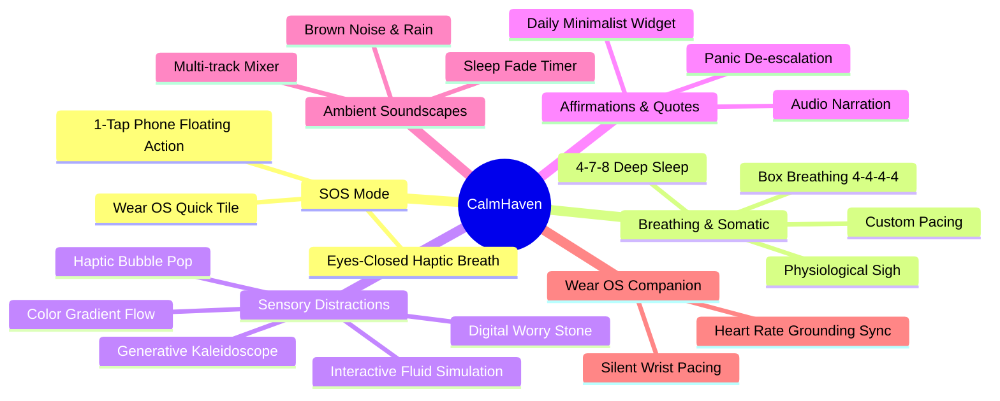
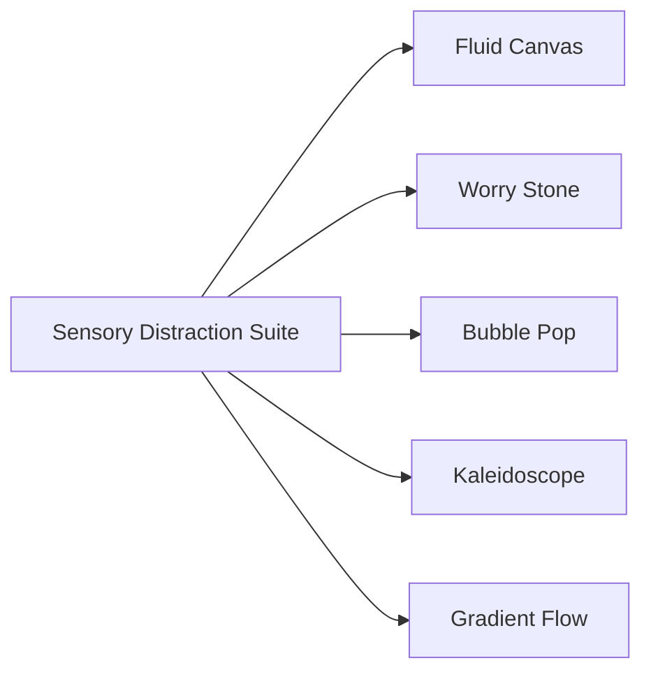
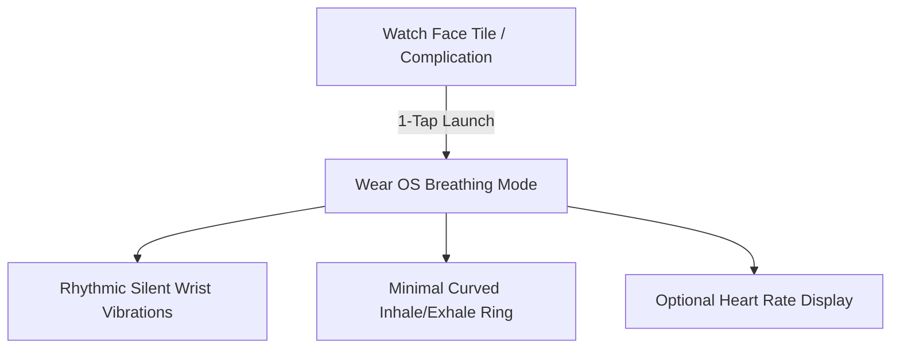
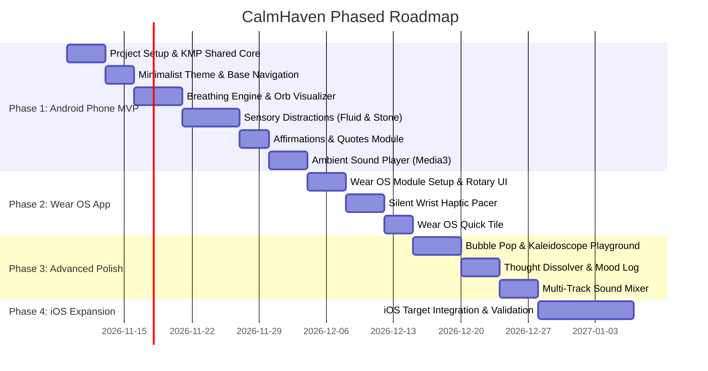

# Product Specification: Ripple (Anxiety Relief & Sensory Grounding)

**Document Version:** 1.2.0  
**Publisher:** Vayu Labs (`meetvayu@gmail.com`)  
**Package:** `com.vayulabs.ripple`  
**Status:** Approved Requirements / Architectural Specification  
**Current Platforms:** Android (Phone & Tablet: API 26+) + Wear OS (API 30+)  
**Future Platform:** iOS (Architecture designed with Kotlin Multiplatform / KMP readiness)  
**Primary Tech Stack:** Kotlin Multiplatform, Compose Multiplatform / Jetpack Compose, Wear Compose  
**Design Aesthetic:** Minimalist Abstract (Ambient Orbs, Soft Gradients, Low Cognitive Load)  

---

## 1. Executive Summary & Product Vision

### 1.1 Vision
Anxiety, sensory overload, and acute panic attacks often overwhelm a person's cognitive bandwidth. **Ripple** (by Vayu) is a minimalist, distraction-free pocket and wrist companion designed to ground users within seconds. Like gentle ripples settling on water, Ripple helps users decelerate racing thoughts through somatic breath pacing, sensory distractions, and ambient acoustic shielding.

### 1.2 Core Architectural Principles
- **Minimalist Abstract Aesthetic:** No cluttered imagery or overwhelming animations. Uses fluid gradient orbs, soft color fades, and generous whitespace.
- **Wear OS First-Class Companion:** Silent, wrist-guided haptic breathing enables discreet grounding in public situations (classrooms, meetings, transit) without looking at a phone screen.
- **Multiplatform-Ready Foundation:** Clean Architecture with **Kotlin Multiplatform (KMP)** separation of domain, state machines, and business logic. Enables frictionless porting to iOS in future milestones while using native Compose on Android & Wear OS today.
- **Offline & Private:** 100% of emergency tools, breathing pacers, sensory toys, and journals work without internet access. Zero tracking of vulnerable emotional states.

---

## 2. Platform Strategy & Multiplatform Architecture

```mermaid
graph TB
    subgraph Shared_KMP_Core [Shared KMP Core (Kotlin Multiplatform)]
        BreatheEngine[Breathing Pacer State Machine]
        QuotesRepo[Affirmations & Quotes Repository]
        MoodRepo[Mood & Journal Engine]
        AudioControl[Audio Sequencing & Timer Logic]
    end

    subgraph Android_Target [Android Phone App (Compose)]
        PhoneUI[Jetpack Compose Material 3 UI]
        PhoneSensory[Canvas Fluid & Sensory Engine]
        PhoneHaptics[Android VibrationEffect Service]
        PhoneAudio[Jetpack Media3 / ExoPlayer Engine]
    end

    subgraph WearOS_Target [Wear OS Watch App (Wear Compose)]
        WearUI[Wear Compose Rotary / Tile UI]
        WearTiles[Wear OS Quick-Breathe Tile]
        WearHaptics[Direct Silent Wrist Vibrator]
    end

    subgraph Future_iOS_Target [Future iOS App (SwiftUI / Compose Multiplatform)]
        iOSUI[SwiftUI or Compose Multiplatform iOS]
        CoreHaptics[iOS CoreHaptics]
        AVAudio[AVAudioEngine]
    end

    Shared_KMP_Core --> Android_Target
    Shared_KMP_Core --> WearOS_Target
    Shared_KMP_Core -.-> Future_iOS_Target
```

### 2.1 Multiplatform Readiness Breakdown
1. **Shared Logic (`commonMain`):**
   - Breathing timers, inhale/hold/exhale phase transitions, state flows.
   - Affirmation database and daily rotation algorithm.
   - Mood tracking data models and SQLite/Room schema.
   - 5-4-3-2-1 grounding state machine.
2. **Android Phone Implementation (`androidMain`):**
   - Rich interactive Compose Canvas for fluid dynamics and particle physics.
   - Multi-channel background audio playback with `Jetpack Media3`.
   - Android 12+ Rich Haptics (`VibrationEffect.createWaveform`).
3. **Wear OS Implementation (`wearMain`):**
   - High-contrast, curved circular UI optimized for small screens.
   - **Wrist Haptic Engine:** Sharp transitions and silent pulses so users can keep their eyes closed.
   - **Wear OS Tile:** 1-tap start from watch face without opening app drawer.
4. **Future iOS Extension (`iosMain`):**
   - Shared business logic connects directly to SwiftUI or Compose Multiplatform for iOS using `CoreHaptics` and `AVAudioPlayer`.

---

## 3. Visual & Aesthetic Identity: Minimalist Abstract

### 3.1 Design Principles
- **No Realistic Clutter:** Avoid photorealistic images or complex illustrations that add visual noise.
- **Ambient Morphing Orbs:** Central breathing and grounding elements are rendered as soft, luminescent gradient orbs that expand, contract, and diffuse organically.
- **Muted, Subdued Palette:** Dark mode by default to reduce ocular fatigue and photophobia during panic.

| Element | Dark Mode Color | Light Mode Color | Function |
| :--- | :--- | :--- | :--- |
| **Deep Canvas** | `#0D1117` (Deep Obsidian) | `#F8F9FA` (Soft Cloud) | Background |
| **Primary Orb** | `#648BA2` -> `#9AB9C9` (Mist Azure) | `#A3C4D8` -> `#CDE2EC` | Main breathing anchor |
| **Secondary Accent** | `#A89F91` (Warm Dune) | `#8C7E6C` (Clay) | Grounding highlights |
| **Soft Sage** | `#5F7F70` (Muted Pine) | `#A0B7AA` (Light Sage) | Success & Calm states |
| **Typography** | `#E6EDF3` (Soft White) | `#1A202C` (Charcoal) | High legibility |

### 3.2 Typography & Motion
- **Font:** *Lexend* or *Plus Jakarta Sans* (engineered for readability and low cognitive strain).
- **Motion Easing:** Custom cubic bezier curves (`0.25, 0.1, 0.25, 1.0`) ensuring natural deceleration with no abrupt stops or harsh bounces.

---

## 4. Key Functional Modules



---

### 4.1 One-Tap SOS Quick Ground (Phone + Wear OS)
- **Phone:** Instant access floating button or home screen shortcut. Tapping bypasses any navigation, instantly rendering the gentle pulsating orb with physiological sigh pacing and calming haptics.
- **Wear OS:** Dedicated watch face **Tile** and **Complication**. A single tap on the watch begins immediate rhythmic wrist pulses, guiding the user to exhale longer than inhale without needing to glance down.

---

### 4.2 Breathing & Somatic Engine

Supports visual expansion/contraction of the minimalist orb, synchronized with auditory chimes and haptic patterns:

1. **Physiological Sigh (Stanford Neurobiology):**
   - 2 quick inhales through the nose (fill alveoli) + 1 prolonged mouth exhale.
   - Fastest physiological mechanism to reduce autonomic arousal.
2. **Box Breathing (4-4-4-4):**
   - Inhale 4s -> Hold 4s -> Exhale 4s -> Hold 4s.
   - Ideal for de-escalating fight-or-flight states.
3. **4-7-8 Relaxing Rhythm:**
   - Inhale 4s -> Hold 7s -> Exhale 8s.
   - Stimulates vagus nerve activation, pre-sleep settling.
4. **Resonant / Coherence (5.5s - 5.5s):**
   - Optimizes heart rate variability (HRV).

---

### 4.3 Deep Dive: Sensory Distractions Suite

Anxiety often traps attention in cognitive loops. Sensory tools provide non-demanding, non-judgmental sensory inputs to divert focus back into the present body.



#### 1. Interactive Fluid Canvas (Fluid Dynamics Simulation)
- **Concept:** A minimalist, low-viscosity fluid simulation running on a Compose Canvas.
- **Interaction:** Touching and dragging the screen creates swirling, silky pastel smoke trails that gently disperse and dissolve over time.
- **Goal:** Mesmerizing, slow visual feedback that induces a hypnotic, tranquil state. No scores, no objectives.

#### 2. Digital Tactile Worry Stone (Haptic Friction)
- **Concept:** A smooth, minimalist oval stone centered on screen with subtle drop-shadow and texture gradients.
- **Interaction:** Swiping or rubbing a thumb across the stone triggers real-time dynamic micro-haptics (varying vibration frequencies based on drag speed).
- **Goal:** Emulates the ancient calming practice of rubbing an agate or quartz worry stone, grounding restless hands.

#### 3. Physics Bubble Pop Grid
- **Concept:** A grid of soft, translucent pastel bubbles.
- **Interaction:** Tapping or sliding across them pops the bubble with a crisp 15ms haptic snap and a muted, gentle organic "pop" sound.
- **Mechanic:** Bubbles automatically reform with a gentle fade-in after 3 seconds, offering an infinite calming tactile fidget toy.

#### 4. Generative Abstract Kaleidoscope
- **Concept:** 6-fold or 8-fold rotational symmetry drawing canvas.
- **Interaction:** Touching and drawing with one finger replicates the stroke across multiple symmetrical axes in soft pastel neon against obsidian.
- **Auto-Fade:** Lines slowly dissolve over 10 seconds, letting users draw continuous mindful patterns without cluttering the screen.

#### 5. Color Drift / Gradient Sorting
- **Concept:** A calming cognitive reset. Blocks of subtly varying pastel hues arranged out of order.
- **Interaction:** The user gently slides color tiles into a smooth chromatic spectrum (e.g., lavender into twilight blue).
- **Goal:** Engages the visual cortex in an untimed, low-stress sorting task that pulls active attention away from anxious thoughts.

---

### 4.4 Inspiring Quotes & Calm Affirmations
- **Categorization by Need:**
  - *Acute Panic:* ("This surge is temporary. It will peak and fade.", "I am physically safe right now.")
  - *Overthinking & Rumination:* ("I don't have to solve everything today.", "Thoughts are clouds, not facts.")
  - *Self-Compassion:* ("I allow myself to breathe and just be.")
- **Minimalist Card Deck:** Swipe up/down between quotes with elegant cross-dissolve transitions.
- **Audio Voiceover:** Optional calm, soothing narration for each quote.
- **Daily Lock Screen & Home Screen Widget:** Displays one gentle reminder updated daily.

---

### 4.5 Ambient Soundscapes & White Noise
- **Offline High-Fidelity Audio Tracks:**
  - Heavy Rain on a Skylight
  - Ocean Surf / Distant Tide
  - Deep Brown Noise (attenuates higher frequencies that trigger hypervigilance)
  - Soft Forest Wind & Leaves
  - Ambient Synth Drone (432 Hz frequency)
- **Multi-Track Mixer:** Run up to 3 sounds together with individual volume faders.
- **Sleep Timer:** Automatic fade-out with gradual volume reduction over 15 to 60 minutes.

---

### 4.6 Wear OS Smartwatch Companion App



1. **Independent Watch Execution:** Can run completely standalone on the watch when leaving the phone behind (e.g., during walks or workouts).
2. **Silent Eyes-Closed Guidance:**
   - Inhale: Gentle rising pulse pattern.
   - Hold: Double sharp tap.
   - Exhale: Gentle falling rhythm.
   - Enables users to calm down discreetly in public meetings or social situations.
3. **Watch Tile:** Swipe left from watch face to reveal the "Quick Breathe" tile with immediate start buttons for 1-minute or 3-minute sessions.

---

### 4.7 Private Thought Dissolver & Journal
- **"Burn After Writing" Mode:** Anxious thoughts typed into a simple minimalist field. When the user taps "Release", the text dissolves into fading dust particles, offering symbolic catharsis.
- **Mood Tracking:** Pre- and post-session calm rating (1 to 5 dots) to visually show users that their distress reduced after an exercise.
- **Security:** Local storage with optional Android BiometricPrompt (Fingerprint/Face unlock).

---

## 5. Technical Specifications & Architecture

### 5.1 Project Module Structure (KMP Ready)

```text
calmhaven/
├── shared/                     # Kotlin Multiplatform Shared Core
│   ├── commonMain/
│   │   ├── domain/             # Use cases (StartBreathing, GetDailyQuote, LogMood)
│   │   ├── model/              # State models, Quote, BreathingTechnique
│   │   ├── repository/         # Data contracts
│   │   └── statemachine/       # BreathingPacerStateMachine (Phase, Millis, Progress)
│   ├── androidMain/            # Android platform specifics (Room DB drivers)
│   └── iosMain/                # Prepared for future iOS SQLite/UserDefaults
├── androidApp/                 # Android Phone & Tablet Application (com.vayulabs.ripple)
│   ├── src/main/java/com/vayulabs/ripple/
│   │   ├── presentation/       # Jetpack Compose UI (Screens, Theme, Components)
│   │   ├── sensory/            # Fluid canvas, bubble grid, worry stone composables
│   │   ├── audio/              # Media3 ExoPlayer background playback service
│   │   └── haptics/            # VibrationEffect custom waveform player
├── wearApp/                    # Wear OS Smartwatch Application (com.vayulabs.ripple.wear)
│   ├── src/main/java/com/vayulabs/ripple/wear/
│   │   ├── presentation/       # Wear Compose circular UI
│   │   ├── tile/               # Wear OS Quick Breathe TileService
│   │   └── haptics/            # Watch vibrator controller
└── build.gradle.kts            # Root build script
```

### 5.2 Key Dependencies & Libraries
- **Shared:** `kotlinx.coroutines`, `kotlinx.datetime`, `kotlinx.serialization`
- **Android Phone:**
  - UI: `androidx.compose.ui:ui`, `androidx.compose.material3:material3`
  - Audio: `androidx.media3:media3-exoplayer`
  - Persistence: `androidx.room:room-ktx`, `androidx.datastore:datastore-preferences`
  - Dependency Injection: `com.google.dagger:hilt-android`
- **Wear OS:**
  - `androidx.wear.compose:compose-material`, `androidx.wear.compose:compose-foundation`
  - `androidx.wear.tiles:tiles`

---

## 6. Implementation Roadmap



---

## 7. Next Steps & Execution Plan

With the requirements aligned on **Minimalist Abstract Aesthetics**, **Rich Sensory Distractions**, and **Android + Wear OS (with future iOS readiness)**:
1. Initialize the project repository with the modern multi-module Kotlin Multiplatform structure.
2. Build the shared **Breathing Pacer State Machine** and **Domain Models**.
3. Implement the Jetpack Compose Phone UI with the ambient morphing orb and sensory canvases.
4. Implement the Wear OS companion module with silent wrist haptics and the Wear OS Tile.
